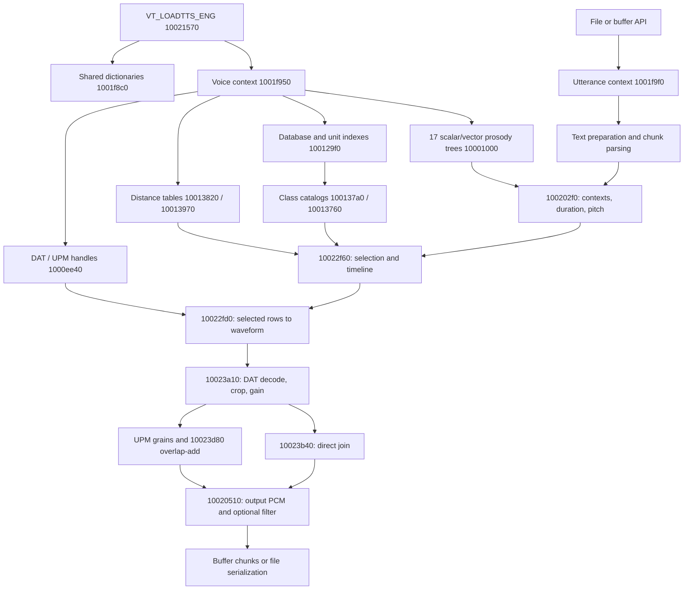

# The 2006 VoiceText concatenative engine: loading to PCM

## Scope and evidence

This REA examination follows the original Kate MSI's 2006 `vt_eng.dll` from
resource loading through prosody, candidate selection, and waveform synthesis.
Target SHA-256:
`00fc9375d08bd8cec303845c992481d79c8f616d1bfb6390a5322cd06f69273d`.
The target is the original extracted DLL, not one of the comparison patches.
Ghidra 12.1.4 pseudocode, assembly, and references are static observations;
types, especially x87 arguments and return values, can be inaccurate.

The [initial REA pass](rea-2006-engine-examination-2026-10-19.md) covered the
API inventory and part of the index/scorer path. This continuation follows
the connected core and alternative audio paths. It does not execute the DLL,
implement an engine, or claim full behavioral parity. Existing runtime results
are cited separately from fresh static observations.

Portable evidence is collected under
[`rea-2006-core-2026-10-19`](../../tools/revkit/work/rea-2006-core-2026-10-19/README.md).
It contains complete compressed REA bundles, function-to-Evidence ledgers,
and read-only asset byte observations. Vendor assets were not modified.

## Connected path

Addresses in the diagram omit the `0x` prefix for readability. Edges summarize
the observed call chains, sometimes through intermediate wrappers. The detailed
selection and audio notes provide the intermediate functions.

## Voice asset loading

`VT_LOADTTS_ENG` delegates shared initialization to `0x1001f8c0` and
per-voice initialization to `0x1001f950`. Shared state occupies `0x2049c`
bytes; a voice context occupies `0x3850` bytes. These are separate from the
much larger utterance context allocated for synthesis. Shared initialization
uses `dict-eng` resources through `0x1000e930` / `0x1000e820`, including
dictionary loader `0x10003550`; the full linguistic dictionary implementation
is outside this concatenative-core walk.

`0x10014f90` prepares voice paths involving `data-%s`, the model directory,
`dat`, `ttsdata`, and `tree`. `0x1000eff0` performs staged loading in this order:

| Stage | Implementation | Failure code written by wrapper |
| --- | --- | --- |
| Prosody trees | `0x1000eb20` → `0x10001000` | 8 |
| Distance tables | `0x1000ec70` → `0x10013820`, `0x10013970` | 6 |
| Database/unit and class indexes | `0x1000ed30` | 7 |
| Optional history files when enabled | `0x1000eb60` → `0x10013d20` | Helper failure propagates |
| DAT banks then UPM banks | `0x1000ee40` | 9, then 10 |

These are observed wrapper assignments, not runtime error-injection results.
DAT and UPM files have distinct per-bank handle arrays at voice `+0` and
`+4`. The number of handles is the signed 16-bit count at `+0x20`.

### Database and unit catalogs

`0x100129f0` reads `dblist.idx`, allocates `0x68`-byte descriptors for its
index entries, and rejects a declared count greater than 20. Its first pass
reads bank names and unit counts and accumulates global unit ranges; its second
loads the feature arrays into combined storage and adjusts bank identifiers.
It constructs a global bank-name table and per-bank category bytes, checks
layout consistency, and rejects a per-unit stride of 201 or more.

`0x10012960` recognizes an optional length-prefixed `ver.` header.
`0x10012140` reads bank count/name/tag entries.
`0x10012450` dispatches to column-tail reader `0x100123a0` for versioned
indexes, or `0x10012210` for the older interleaved record layout. Thus the
2006 engine has two index paths; the prior REA tail description applies to
the versioned Kate inputs, not every admitted index.

Fresh read-only inspection of the matching MSI assets gives:

| Index | Units | Record offset | Feature-tail offset | File bytes |
| --- | ---: | ---: | ---: | ---: |
| `unit-gen.idx` | 179,995 | 45 | 3,419,950 | 7,019,850 |
| `unit-gen2.idx` | 98,133 | 46 | 1,864,573 | 3,827,233 |
| `unit-num.idx` | 997 | 45 | 18,988 | 38,928 |
| `unit-etc.idx` | 3,666 | 45 | 69,699 | 143,019 |
| `unit-alp.idx` | 905 | 45 | 17,240 | 35,340 |

All five have 19-byte payload records and 20N tail bytes, totaling 283,696
units. For example, `unit-etc.idx`'s first five-byte key is
`5a 05 13 1e 1e` at file offset 77,031. This anchors the reader's two N-byte
columns followed by 5N key bytes. Full hashes and offsets are retained in
[`asset-byte-observations.json`](../../tools/revkit/work/rea-2006-core-2026-10-19/asset-byte-observations.json).

Class initialization is read-or-build: `0x100137a0` tries `class.idx`
through `0x10013380`, falls back to `0x10013030`, then calls `0x10013320`.
`0x10013760` similarly tries `classhp.idx` through `0x10013570` and falls
back to `0x10024850`. These files are caches/catalogs used by selection;
a missing precomputed file does not by itself establish an unusable voice.

### Acoustic and scalar distance tables

`0x10013820` reads a signed 16-bit dimension and a triangular array of
32-bit values, then builds row pointers. The matching Kate `cepdist.tbl`
starts `00 04` at offset 0: little-endian 1,024. Its 524,800 float-sized
entries start at offset 2, and `2 + 4 * 1024 * 1025 / 2` exactly matches
its 2,099,202-byte size. Use sites treat the values as floating distances.

`0x10013970` builds an additional 256-bin triangular float table using
`0x10013920`. For bins a and b, its recovered formula is
`(a-b)^2 / ((a+b)/2)`, with zero when the mean is zero. The raw acoustic
table and derived scalar table serve different terms in local/transition
scoring; they are not interchangeable.

`0x1001f8b0` returns zero, supplying the byte-order flag used during normal
load initialization. Together with the little-endian x86 target and the sample
bytes, this resolves the earlier uncertainty about the normal copy path:
`0x10001480` copies these inputs without reversal. Its conditional reversal
branch still exists; this is not a claim about every possible global mutation.

## Prosody trees and context production

`0x10001000` loads nine duration trees (`vshort`, `vlong`, `vdi`, `vsch`,
`cstop`, `cfri`, `caff`, `cnas`, `capp`) and eight pitch trees
(`nbt`, `nbf`, `bt`, `bf`, `qbt`, `qbf`, `sbt`, `sbf`).

The loaders have two distinct node formats:

| Family | Loader / recursion / node reader | In-memory node bytes | Evaluator |
| --- | --- | ---: | --- |
| Scalar | `0x100017d0` / `0x10001740` / `0x100015d0` | 20 | `0x10001570` |
| Vector | `0x10001c80` / `0x10001bf0` / `0x10001a30` | 24 | `0x100019b0` |

Both loaders first count nodes and list/output entries, allocate arrays, then
repeat the recursive walk to populate them. `D` chooses by membership;
the other evaluator branch compares a signed feature with a signed threshold,
taking the first child for values at or below the threshold. Leaves return
a scalar or copy an output vector.

### Correction: the four pitch vector files

The earlier scalar-only tree description cannot describe `bf`, `nbf`,
`qbf`, or `sbf`. Their serialized node format, read by `0x10001a30`, is:

| Relative offset | Width | Field |
| --- | --- | --- |
| 0 | 1 | Feature selector |
| 1 | 1 | Operation |
| 2 | 2 | Signed little-endian threshold |
| 4 | 1 | Output width W |
| 5 | 2W | Signed little-endian output vector |
| 5+2W | 1 | Membership count L |
| 6+2W | 2L | Signed little-endian membership entries |
| 6+2W+2L | 2 | Trailer bytes; second controls two-child recursion |

In memory the vector pointer is `+0x0c`, threshold `+0x10`, feature `+0x12`,
operation `+0x13`, output width `+0x14`, membership count `+0x15`, and
membership pointer `+8`. These differ from the scalar node offsets.

Following that exact layout consumes all four original Kate files to EOF:

| File | Bytes consumed = file bytes | Nodes | Leaves | Every node's W |
| --- | ---: | ---: | ---: | ---: |
| `bf.tree2` | 812 | 21 | 11 | 12 |
| `nbf.tree2` | 19,940 | 561 | 281 | 12 |
| `qbf.tree2` | 254 | 7 | 4 | 12 |
| `sbf.tree2` | 3,700 | 99 | 50 | 12 |

For `bf.tree2`, offset 0 holds feature 11, operation `D`, threshold 0,
width 12. Its output words occupy offsets 5–28, count 2 is at 29,
membership words occupy 30–33, and `01 01` occupies 34–35.
The first output vector is `84,84,85,86,88,91,95,99,102,104,101,97`.
Hashes and root fields are in
[`vector-tree-byte-observations.json`](../../tools/revkit/work/rea-2006-core-2026-10-19/vector-tree-byte-observations.json).
This resolves the apparent suffix for these four Kate files. Other voice
packages were not re-parsed under this vector layout in this pass.

### From parsed text to targets

`0x100202f0` is the connecting preparation routine. It calls `0x1001c180`
for successive parsed chunks, `0x10010620` to install phone/context records,
`0x1000f3e0` for boundaries, `0x1001b800` and mode-specific helpers, then
`0x1000f5a0` for duration and `0x1000fd30` for pitch.

`0x1001c180` calls the text parser at `0x100546d0`, carries input spans into
`0x2fc`-byte context records, and recognizes exhaustion. `0x10010620`
copies internal phone bytes in the range 1–69, treats `d` as a modifier of
the preceding phone, caps the scanned pronunciation length at 65, and records
punctuation classes for comma/period/exclamation/question mark.

Duration producer `0x1000f7f0` constructs nine signed feature slots containing
mapped current/neighbor phone classes, categorical attributes, a boundary
position code, and counts. `0x1000f5a0` chooses among the nine scalar duration
trees via tables and stores their returned shorts. Names of all categories and
the physical units of every result are not established by this walk.

Pitch producer `0x1000fe90` fills eleven feature slots. `0x1000fd30`
selects scalar/vector pairs according to boundary markers `^`, `Z`, `[`, or
the ordinary case. It stores the scalar result as a byte, supplies that result
in the final stack feature slot, and invokes the vector evaluator. It then calls
`0x1000fa70`, which adjusts adjoining contour vectors. Its x87 pseudocode
contains damaged temporaries and an apparent division by zero; assembly
inspection recovers the stack-resident values and the square-root helper.
There is no literal forced division by zero in that instruction sequence.

For adjoining 12-bin contours X and Y, the routine takes medians of
`sqrt(X[i]^2/2)` for i=5..11 and `sqrt(Y[j]^2/2)` for j=0..6. Let these
be mX and mY, and m their mean. It applies a linear scaling ramp from 1 to
`sqrt(m/mX)` across X, and from `sqrt(m/mY)` to 1 across Y. It then replaces
X[5..11] and Y[0..6] with 14 points on a straight line between the scaled
X[5] and Y[6], and converts back to shorts after adding 0.5. The
[assembly walk](../../tools/revkit/work/rea-2006-core-2026-10-19/pitch-smoothing-notes.md)
records the helper identities and Evidence IDs. This is recovered static
math; zero/negative contour behavior and runtime numerical parity remain open.
The routine updates contours in place, so an interior contour participates in
two ordered boundary operations. Its precise x87 evaluation order and
single-precision stores matter; the algebraic summary above is not a
byte-exact oracle.

## Utterance state and output loop

`0x1001f9f0` allocates `0x12cb20` bytes for an utterance, wires its linguistic
context at `+0x54`, creates 10,000 candidate scratch objects of 20 bytes,
allocates synchronization structures, and creates two 60,000-byte output
buffers. This is per-utterance state, distinct from loaded voice state.

`0x10021f10` applies caller controls and points the linguistic context at
per-position parameter arrays. A supplied nonnegative speed becomes
`10000 / speed`, except speed zero maps to 200; negative controls select
default/inherited behavior through flag bytes. This inversion matters when
mapping public speed to internal timing scales.

`0x10020750` initializes input position and repeatedly calls preparation until
a usable chunk or completion. `0x10020460` repeatedly invokes `0x10022f60`
and advances context positions, requesting another prepared chunk when needed.
`0x10020510` points it at the caller's PCM buffer, then optionally applies a
stateful adjacent-sample filter controlled by voice `+0x383c`. Positive and
negative coefficient branches differ in whether feedback uses transformed or
original preceding samples; saturation is visible. This is an additional
postprocessing stage, not part of DAT decompression.

Buffer format 0 (`S16PCM` in the shipped header) uses `0x10018ba0`:
flag 0 starts, 1 continues, and 2 cancels; a negative flag reports a
60,000-byte buffer requirement. It returns full chunks with carry state,
eventually returns 1 on completion, and frees the utterance. Other formats
have separate workers. These statements describe recovered control flow,
not a fresh buffer lifecycle runtime test.

For WAVE output, public format 4 goes through `0x10017320` with internal
format 1 into `0x10017420`. It uses the same preparation and PCM producer,
then serializes chunks. `0x10017ce0` creates RIFF/WAVE fields; internal
format 1 specifies PCM, one channel, 16,000 Hz, 16 bits, and block alignment
2. `0x100180f0` updates and rewrites RIFF/data lengths. File formats 0–5
and 7–9 have dispatch arms; public format 6 takes the default error arm.
Codec conversion and playback are wrappers around the core and were not
exhaustively reconstructed here.

## Selection and waveform details

### Candidate generation and sequence choice

`0x10022f60` calls global selector `0x1001e470`. It first tries whole
positions; insufficient class population causes two half-position lookups.
Whole keys use seven-byte class views and split keys use eight-byte views,
with progressively relaxed prefix matching. `0x1001cff0` expands class
membership into at most 10,000 temporary unit candidates and returns at most
30 after continuity and target ranking. Consecutive unit membership across
neighboring positions influences retention and the target feature weight.

The global recurrence is
`D[t,c] = target[t,c] + min_p(D[t-1,p] + acoustic[p,c] + symbolic[p,c])`.
Acoustic costs combine triangular-table distances for three endpoint features.
They have zero-cost shortcuts for a shared split unit and flagged consecutive
units. Symbolic costs are evaluated separately. A heuristic prune on lists
longer than ten keeps candidates at or below `mean + (mean-min)/4`, plus
candidates with right continuity. Backtracking follows signed 16-bit predecessor
indices and materializes the chosen units. It finds a path over those retained
candidates; it is not an exhaustive optimum over the full voice inventory.

### Selected waveform to output samples

`0x10022fd0` creates a timeline from the selected records, reads/decompresses
DAT units through `0x10023a10`, crops the selected portions, and applies gain.
The selection-to-audio handoff is explicit: `0x10013cf0` locates the index
bank/global-to-local ID, dispatches to compact reader `0x10013bc0` or older
interleaved reader `0x10013a40`, and produces a 20-byte descriptor. Its asset
bank comes from the rebased unit map and need not equal the index-bank ordinal.
For original selected ID 272822, the compact record is local row 92827 of
`unit-gen2.idx`, file offset 1763759. Its counts 664 and 610 and middle
period 32 yield `664 + 610 - 2*32 = 1210` samples; its last period 36 yields
a 72-sample trailing span. The audio notes retain the raw 19 bytes, field
mapping, reader evidence, and connection to the prior Hello runtime capture.

At unchanged pitch/duration, `0x10023b40` carries each nonfinal trailing span
into the next row and blends the overlap using an 8,192-entry table. The
weighted sum is clamped before integer conversion. Existing matched-2006
runtime evidence corroborates this direct path; no new runtime was executed.

At changed scales, `0x10024460` reads UPM interval bytes and doubles them;
`0x10024520` constructs grain records; and `0x10023d80` selects and windows
those grains. Output pulse spacing and progression through source audio use
separate scales. This supports a pitch-synchronous overlap-add interpretation.
The adjusted branch is connected statically, with numerical parity still open.

The DAT decoder at `0x10001d50` requires assembly inspection: Ghidra omits
predictor handlers reached through a computed jump. The audio evidence retains
the jump-table and handler bytes, the MSB-first Rice residual primitives, and
order-0 through order-3 predictor formulas. A successful top-level decompilation
does not establish complete decoder-body coverage.

The following sections link the two focused REA walks, each with its own full
evidence bundle and address ledger:

- [Candidate generation, costs, pruning, and backtracking](../../tools/revkit/work/rea-2006-core-2026-10-19/selection-notes.md).
- [Selected rows, DAT/UPM decoding, direct joins, and adjusted synthesis](../../tools/revkit/work/rea-2006-core-2026-10-19/audio-notes.md).

## Coverage and remaining uncertainty

| Requested area | Result of this walk | Remaining boundary |
| --- | --- | --- |
| Asset loading | Connected staged path, bank/index readers, class fallback, distance tables | Not every malformed-resource/error path executed |
| Prosody | Scalar/vector formats, duration/pitch producers, assembly-derived contour smoothing, four vector files checked against bytes | Category meanings and runtime contour parity remain open |
| Candidate generation and local scoring | Detailed in selection notes | Recovered x87 signatures require caution |
| Sequence choice | Connected global search and backtracking | Static algorithm is not corpus parity |
| Waveform construction | Direct and adjusted paths followed in audio notes | Alternate branches have no fresh runtime captures |
| Output | Shared PCM loop, optional filter, S16 WAVE serialization | Other codecs, playback, and sync semantics not exhaustive |

An exported bundle's empty machine unknown registry does not mean there are
no unknowns; this report and the focused notes record the actual coverage.
The next implementation-critical gaps are complete categorical feature semantics,
runtime validation of contour smoothing, and runtime comparison of the adjusted
synthesis branch. The engine's core is now connected statically;
it is not a fully recovered, tested replacement.

## Validation performed

The five compressed REA exports contain 129 records (127 distinct Evidence
IDs) and preserve their original complete JSON. All gzip streams and JSON
documents were read successfully; target identities and all Evidence IDs cited
by the new notes were checked. A
[manifest](../../tools/revkit/work/rea-2006-core-2026-10-19/evidence-manifest.json)
records compressed/uncompressed hashes, sizes, and counts. Local report links
were checked, `git diff --check` passed, and the original DLL's final hash
matches the input identity above. All opened native sessions were closed.

No implementation or parser code changed. No unit tests, engine runtime
probes, lint, or type checks were run for this documentation/evidence task.
The raw asset checks cover the five original Kate indexes, its distance-table
extent, and four pitch-vector trees; they do not broaden into corpus PCM parity.
